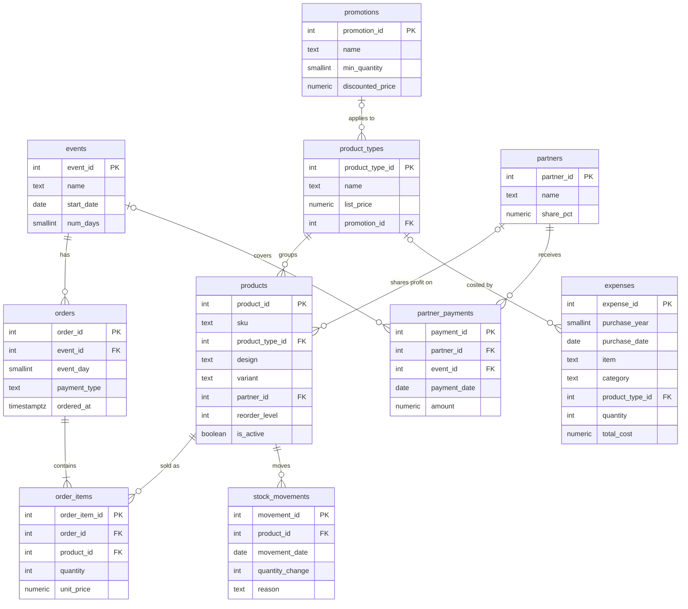

# Data Model

This document covers Phase 5: the database design for the new system. It is built from the data each [business question](business-questions.md) needs, and implemented in PostgreSQL in [`sql/schema.sql`](../sql/schema.sql).

## Entity relationship diagram

## Tables

| Table | One row per | Answers |
| --- | --- | --- |
| `events` | market attended | Q2, Q3 |
| `orders` | customer payment | Q2–Q5 |
| `order_items` | product within an order | Q1–Q6 |
| `product_types` | kind of product (Sticker, Sticker Sheet, Print, Shirt, Pin) | Q1, Q4 |
| `products` | design, plus size for shirts | Q1, Q6, Q7 |
| `promotions` | quantity-based discount | Q4 |
| `partners` | person who receives a profit share | Q6 |
| `partner_payments` | payment made to a partner | Q6 |
| `expenses` | purchase of anything | Q1, Q2, Q6 |
| `stock_movements` | stock change other than a sale | Q7 |

Two views do the calculations every question relies on:

- **`v_type_avg_cost`**: weighted average cost per product type (Solution 5).
- **`v_stock_levels`**: current stock per design and whether it needs reprinting (Solution 7).

## Worked example: one transaction

A customer buys **1 P1_Shark, 1 SS1_Willow and 1 S4_Bestfriends1**, paying by PayNow on day 1 of an event.

These are 3 items from the sheets-and-prints group, so the promotion applies and each costs $2.00 instead of $2.50.

**`orders`**: one row for the payment.

| order_id | event_id | event_day | payment_type | ordered_at |
| --- | --- | --- | --- | --- |
| 101 | 6 | 1 | paynow | 2026-12-05 14:32 |

**`order_items`**: one row per product, each with the price actually paid.

| order_item_id | order_id | product_id | quantity | unit_price |
| --- | --- | --- | --- | --- |
| 251 | 101 | 31 (P1_Shark) | 1 | 2.00 |
| 252 | 101 | 1 (SS1_Willow) | 1 | 2.00 |
| 253 | 101 | 4 (S4_Bestfriends1) | 1 | 2.00 |

Nothing else is written. Everything below is calculated from these four rows:

| What | Result | Calculated from |
| --- | --- | --- |
| Order total | $6.00 | sum of quantity × unit_price |
| Promotion discount given | $1.50 | 3 × ($2.50 list price − $2.00 paid) |
| Stock | Shark, Willow and Bestfriends 1 each go down by 1 | `v_stock_levels` subtracts units sold |
| Summer's share | 50% × ($2.00 − average sticker sheet cost), on Willow only | Willow's `partner_id` links to Summer |

The IDs are examples. `order_id` and `order_item_id` are assigned automatically, and the `product_id` values are the ones the seed file gives these designs.

## Design decisions

### 1. Price and cost belong to the product type; stock belongs to the design

Every sticker sheet sells for the same price, gets the same promotion, and comes from the same mixed print batches. So `list_price`, the promotion and the average cost are stored once per **product type**. Stock and Summer's share differ by **design**, so they live on `products`.

### 2. The price actually paid is stored on every line item

`order_items.unit_price` records what the customer paid after any promotion. Revenue stays correct even if prices or promotions change later.

### 3. Each fact is recorded once

- Sales are not copied into `stock_movements`. Stock is calculated as all movements − all units sold.
- Totals, profit and stock are never stored. They are calculated by views and queries, so they can't disagree with the transactions (Solution 3).

### 4. All purchases go in one `expenses` table

This mirrors the old Expenses tab. A purchase linked to a product type feeds the average cost; an unlinked one (display, tools, delivery) is overhead. A constraint makes product purchases include a quantity, since the average cost needs it.

### 5. Historical data is allowed to be incomplete

Old records lack some details, so those columns accept `NULL` and are filled for every new sale:

- `orders.payment_type` and `orders.ordered_at`
- `expenses.purchase_date` (the year is always required)

Old sticker-sheet sales with no design are recorded against a **"Design not recorded"** product, which is marked inactive so it never appears in the sales form.

### 6. Rules are enforced by the database

`CHECK` and foreign-key constraints reject bad data at entry. For example, a quantity of 0, a payment type other than cash or PayNow, a purchase date outside its stated year, or a sale of a product that doesn't exist.

### 7. No customer data is stored

Customer names from the old Remarks column are not carried over. This keeps the database safe to work with and simplifies the public version (Phase 6).